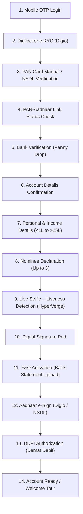

# 🔬 Deep APK Decompilation & Reverse Engineering Report
## Sahi Trading App (`com.aaritya.sahi_trade_app`)

> **Decompiled with:** `jadx-headless-mcp v0.8.0` + Static Asset / Manifest Extraction  
> **Target APK:** `base.apk` (55.3 MB, SHA-256: `9fff890ca793882e229d29a17b7c87931056556d6df3e88524ff037bb715e19f`)  
> **Target Android Version:** Android 15/16 (compileSdkVersion 36, targetSdkVersion 36, minSdkVersion 24)

---

## 🚀 Key Discovery: Frontend Architecture

Contrary to standard native-only Android assumptions, **Sahi is built using Flutter (Dart)** wrapped in a native Android shell with a multi-package modular architecture.

```
┌───────────────────────────────────────────────────────────────┐
│                    SAHI FLUTTER RUNTIME                       │
├─────────────────┬───────────────────┬─────────────────────────┤
│  ai_assistant   │      chart        │     mscalper_train      │
│ (Kyro AI orb &  │  (Custom Canvas   │   (Scalper practice &   │
│  Lottie loader) │   engine)         │    execution engine)    │
├─────────────────┼───────────────────┼─────────────────────────┤
│  sahiscript_ui  │ system_indicators │          dls            │
│ (Custom Script  │  (18 Built-in AI  │  (Design Language       │
│  PineScript-alt)│   Indicators)     │   System UI Library)    │
├─────────────────┼───────────────────┼─────────────────────────┤
│    upi_apps     │  flutter_inapp    │    moengage_flutter     │
│ (UPI Intents)   │    webview        │   (User Engagement)     │
└─────────────────┴───────────────────┴─────────────────────────┘
```

---

## 1. Modular Flutter Packages Discovered

| Package Name | Purpose & Implementation |
|--------------|-------------------------|
| `packages/chart` | **Custom Canvas Trading Chart Engine** (built in Flutter, rendering candles, volume, and overlay indicators at 60fps) |
| `packages/ai_assistant` | **Kyro AI Assistant** — includes Lottie animations: `logo_reveal`, `orb/glow`, `loader_loop`, `thinking_intro.json` |
| `packages/sahiscript_ui` | **SahiScript UI & Editor** — Sahi's proprietary scripting language for custom user indicators with custom fonts (`SahiScriptEmoji.ttf`, `NotoSans`) |
| `packages/mscalper_train` | **Scalper Practice Terminal** — interactive training sandbox with `one_tap_buy_sell`, `exit_at_market`, `playback.svg`, `reset.svg` |
| `packages/system_indicators` | **18 Built-in AI & Technical Indicators** — pre-compiled indicator suite (`svgs.bin`) |
| `packages/dls` & `dls_icons` | **Design Language System** — unified design tokens, dark/light themes, custom icons |
| `packages/upi_apps` | Native Indian UPI intent launcher (GPay, PhonePe, Paytm, CRED) |
| `packages/youtube_player_flutter` | Embedded video player for trading tutorials and research webinars |
| `packages/moengage_flutter` | MoEngage SDK (v10.9.0) for in-app push triggers, drip campaigns, and user segmentation |

---

## 2. Complete 14-Step Digital KYC Onboarding Flow (Decoded)

The APK assets reveal the exact 14-step onboarding journey configured in the app:



### JSON Workflow Definitions Discovered in APK:
1. `onboarding_kra/digilocker_kyc_screen.json`
2. `onboarding_kra/manual_pan_entry_screen.json`
3. `onboarding_kra/pan_confirmation_screen.json`
4. `onboarding_kra/nsdl_pan_dob_mismatch_error.json`
5. `onboarding_kra/aadhar_pan_linking.json`
6. `onboarding_kra/bank_verification_screen.json`
7. `onboarding_kra/confirm_account_details.json`
8. `onboarding_kra/personal_details.json`
9. `onboarding_kra/nominee_screen.json`
10. `onboarding_kra/selfie_verification_screen.json` + `selfie_rejection.json`
11. `onboarding_kra/trackpad_signature.json`
12. `onboarding_kra/fno_onboarding_screen.json`
13. `onboarding_kra/esign.json`
14. `json/ddpi_faq.json`

---

## 3. Third-Party Fintech Vendor Stack (Confirmed from Code & Manifest)

| Vendor | Technology / SDK | Role in Sahi |
|--------|-----------------|--------------|
| **Digio** | `in.digio.sdk.gateway`, `com.digio.kyc_offline`, `com.ecs.dbsekycapi.ESignActivity`, `com.digio.esignMandate` | **Aadhaar e-Sign, e-Mandate, Digilocker integration, Offline KYC, UPI Mandate** |
| **HyperVerge** | `co.hyperverge.hyperkyc.webCore.ui.HKWebCoreActivity` | **AI Document OCR, Liveness Check & Face Match** |
| **MoEngage** | `com.moengage.inapp`, `com.moengage.pushbase`, `com.moengage.firebase` | **In-app Nudges, Push Notifications, User Engagement Analytics** |
| **Freshworks / Freshchat** | `com.freshchat.consumer.sdk.activity.*` (13 activities) | **In-app Customer Support Chat & AI FAQ Bot** |
| **AppsFlyer** | `assets/com/appsflyer/internal/*` | **Ad Attribution & Marketing Campaign Tracking** |
| **New Relic** | `com.newrelic.agent.android.sessionReplay` | **Real-Time APM, Crash Monitoring & Session Replay** |
| **Sentry** | `io.sentry.android` | **Developer Crash Reporting** |
| **Google ML Kit** | `com.google.mlkit.common` | **On-device image processing & barcode/OCR scanning** |
| **NPCI / UPI** | Direct Intent (`queries` for PhonePe, GPay, Paytm, CRED) | **Zero-brokerage instant UPI deposits** |

---

## 4. Proprietary Trading Features Decoded

### A. Sahi Scalper 2.0 & Practice Mode (`mscalper_train`)
- Features a **full paper trading simulator** with playback and reset controls
- **1-Tap Execution:** Pre-configured limit/market buttons without order confirmations
- **Exit at Market:** Panic exit button that cancels all open limit orders and dumps position at LTP

### B. Super Alerts (`json/alerts_faqs.json`)
The app supports two distinct alert engines:
1. **Price-Based Alerts:** Fires when LTP crosses or touches a specified price.
2. **Candle-Based Alerts:** Fires only when a candlestick (1m, 5m, 15m) *closes* above or below a level.
- Custom notification sound: `assets/flutter_assets/sounds/alert_notification_sound.mp3`

### C. PnL Protect (`json/pnl_protect_faqs.json`)
- Trader safety feature allowing users to set maximum daily loss or target profit. Once breached, the system auto-squares off positions and disables trading for the day to prevent revenge trading.

### D. Customisable Option Chain (`json/customise_option_chain.json`)
Allows toggling and reordering columns:
- LTP, LTP Chg, LTP Chg%
- Volume & Volume PCR
- Open Interest (OI) & OI Chg
- Greeks: Delta, Gamma, Theta, Vega

### E. Research & Advisory Module
SEBI Registered Research Analysts featured in app assets:
- **Abhishek Nair** (`ra_abhishek_nair.png`)
- **Gaurav Arora** (`ra_gaurav_arora.png`)
Provides in-app trade calls, target prices, and rationale.

### F. Security & SSL Pinning
- Pinned Root CA: `assets/flutter_assets/assets/ca/isrgrootx1.pem` (Let's Encrypt ISRG Root X1)
- Biometric authentication: Android `BiometricPrompt` with hardware keystore

---

## 5. Practical Blueprint for Building an Identical App

To build a true **1:1 clone of Sahi**, your architecture should mirror their exact setup:

```yaml
Frontend:
  Framework: Flutter 3.24+ (Dart)
  State Management: Bloc or Riverpod
  Charting: Flutter CustomPainter Canvas Engine
  Animation: Lottie (for Kyro orb / loaders)
  Supported OS: Android 7.0+ (API 24+) & iOS 14+

Fintech APIs (India):
  KYC & e-Sign: Digio API (₹15–25/onboarding)
  Liveness & Face Match: HyperVerge HyperKYC (₹10–20/check)
  Customer Support: Freshchat SDK (Freshworks)
  Push & Retention: MoEngage or OneSignal
  Crash & Performance: Sentry + New Relic
  Attribution: AppsFlyer

Backend:
  Language: Go (Golang) / C++ for low latency
  Protocols: WebSockets (binary / JSON tick feed)
  Database: PostgreSQL (ACID ledgers) + Redis (in-memory ticks)
  Event Bus: Apache Kafka (market tick fan-out)
```

